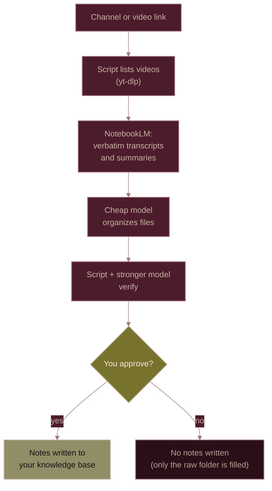

# YouTube to Second Brain


> Learn from a YouTube channel without watching a single video. Pull the knowledge into your own second brain, keep your expensive model's usage low, and put it to work in your own life and business.


**Contents:** [Why](#why-this-exists) · [Learn, store, apply](#learn-store-apply) · [How it works](#how-it-works) · [Who does what](#who-does-what) · [What you get](#what-you-get) · [Video selection](#video-selection-rules) · [Guardrails](#guardrails) · [Requirements](#requirements) · [Install](#install) · [Example prompts](#example-prompts) · [Example conversation](#example-conversation) · [FAQ](#faq) · [Limitations](#limitations) · [Credits](#credits) · [License](#license)

## Why this exists

Every channel you follow holds hours of useful ideas, and almost none of it sticks. You watch, you nod, you forget. Most of the time goes to filler, intros and repeated points, and the good parts are buried.

The usual shortcut is to paste transcripts into your strongest AI model. That is slow, expensive, and it can invent details across long text.

This skill takes a different route. Instead of watching, and instead of burning your best model on raw text, it lets **NotebookLM** do the heavy reading instead of your main model, lets **cheap models and scripts** do the sorting, and uses your **strong model only as the checker**. The result is a channel's best videos (up to 130), checked against the real transcripts, sitting in your notes and linked together.

| | Watching it yourself | Pasting transcripts into a big model | **This skill** |
|---|---|---|---|
| Your time | Hours of watching | Minutes of copy and paste | One link, then one approval |
| Cost | Your time | High token use | Your strong model's usage stays low: heavy reading is offloaded |
| Accuracy | You forget half of it | Can invent details | Numbers and names grepped against the verbatim transcript, then spot-checked |
| Where it ends up | In your memory, briefly | In a chat that scrolls away | In your own linked notes, permanently |

## Learn, store, apply

1. **Learn without watching.** Give it a channel or a video link. It collects the videos, gets the verbatim transcripts, and has NotebookLM produce summaries, rules, lessons and step-by-step workflows. You read the distilled result, not the hours of footage.
2. **Store in your second brain.** After you approve, it writes source cards, lesson pages, rule pages and a hub page into your markdown knowledge base, all linked together and checked against what already exists, so nothing is duplicated.
3. **Apply to your own life.** Workflows are rewritten for the tools you actually use, educational videos come with exercises, and the rules sit next to your own notes where you will really find them again. Knowledge you can act on, not a watch-later list.

## Built to spend little

- **Reading is offloaded.** NotebookLM reads the transcripts, so your main model never has to.
- **Sorting is cheap.** A low-cost model files and pairs things up. It is not allowed to touch transcripts.
- **Your strong model only checks.** It spot-checks the work, writes a short report of what it fixed, dropped or doubted, and presents the result.
- **Nothing is redone.** A resume file remembers every video, so a quota limit or error does not restart the job, and later runs only handle new videos.

You stay in control the whole way: nothing is written to your knowledge base until you say yes.

## How it works



| # | Step | What happens |
|---|---|---|
| 1 | Start | Reads your knowledge base's rules and recent log (if it has them). |
| 2 | List | A script lists the channel's videos (and Shorts, if you choose to include them) and applies the selection rules below. |
| 3 | Links and chapters | Description links and chapter markers are extracted into their own files. |
| 4 | Notebook | All videos of a channel go into one NotebookLM notebook named after the channel. |
| 5 | NotebookLM jobs | Verbatim transcript, bullet summary, rules and lessons, workflow, and exercises when the video is educational. |
| 6 | Organize | A cheap model sorts files; it never edits transcripts. |
| 7 | Verify | A script greps numbers and names against the transcript, then a stronger model spot-checks and writes a check report. |
| 8 | Present | You see videos, context clusters, rules, workflows, links, the check report and any gaps. |
| 9 | Approval gate | Nothing is written to pages, index or log until you say yes. |
| 10 | Write | Source cards, lesson pages, rule pages and a hub page, then index and log updates. |

## Who does what

| Who | Responsible for |
|---|---|
| Scripts (`yt-dlp`, `nlm`) | Lists, exact view counts, verbatim transcripts, link and chapter extraction |
| NotebookLM | Summaries, rules, lessons, workflows, exercises |
| Cheap model or second CLI | Sorting files, simple judgment tasks |
| Stronger model | Verification, check report, context, the final presentation |
| You | Choices (Shorts, video-watching pass) and the approval to write |

## What you get

After you approve, the skill writes into your markdown knowledge base:

- **Source cards** for the videos.
- **Lesson pages** and **rule pages**, one pair per context cluster, plus one "all rules" page.
- A **hub page** that everything links to (a large channel gets its own hub; a single video goes under a topic hub).
- **Narrative formulas** (title, hook, body and call-to-action patterns) stored separately as patterns only.
- An updated **index page** and one new **log line**.

Contradictions with existing pages are shown to you separately, and claims without a source are labeled `[UNVERIFIED]`.

## Video selection rules

| Channel size | What is taken |
|---|---|
| 80 videos or fewer | All of them |
| More than 80 | The 80 most viewed in the last 6 months, plus any of the 50 most viewed of all time not already included, up to 130 in total. A second model scans for important videos the view-count rules missed. |
| Shorts | You decide per channel, after seeing how their median views compare with long videos. |

A per-channel `_processed.json` resume file records progress, so after a quota limit or an error it resumes instead of restarting, and later runs only process new videos.

## Guardrails

- Raw transcripts are never retyped, translated or edited by a model.
- No invented summaries: a video without a transcript is marked "unavailable".
- Other creators' titles and signature phrases are never copied; only patterns are kept.
- Private content is never sent to external tools.
- No deleting or bulk overwriting without your approval.
- If NotebookLM or its CLI fails, you are told; a browser session is a last resort and needs your permission.

## Requirements

| Needed | For |
|---|---|
| Claude Code (or another Claude client with skills) | Running the skill |
| `yt-dlp` | Video lists, exact metadata |
| NotebookLM and its CLI (`nlm`) | Transcripts and summaries |
| A markdown knowledge base (an Obsidian vault works well) | Where the notes are written |
| Optional: a second model CLI such as Gemini | Simple judgment tasks |

## Install

Copy the skill into your Claude skills folder:

```bash
git clone https://github.com/jenny-gecglr/youtube-to-second-brain.git ~/.claude/skills/youtube-to-second-brain
```

Or download the folder and place it at `~/.claude/skills/youtube-to-second-brain`.

## Example prompts

- "Add this channel to my second brain: `<channel link>`"
- "Summarize this video and file it in my notes: `<video link>`"
- "Check this channel for new videos since last time."

## Example conversation

An illustration of the flow (the names and numbers are made up):

```text
You:    Add this channel to my second brain: <channel link>
Claude: The channel has 212 videos, so I selected the 80 most viewed of the
        last 6 months plus the top all-time videos not already included.
        Do you want the Shorts included?
You:    No.
Claude: Transcripts and summaries are ready. The check report: 3 figures were
        not found in the transcripts and were corrected, and 4 videos have no
        transcript, so they are marked "unavailable". Contradictions with your
        existing pages are listed separately.
        Write this to the knowledge base?
You:    Yes.
Claude: Written: source cards, lesson pages, rule pages, the hub page, the
        index entry and one log line.
```

## FAQ

**Does it work without Obsidian?** Yes. Any markdown knowledge base works; Obsidian is just a convenient example.

**Will it copy another creator's content?** No. It stores patterns (for example how a hook is built), never their titles or signature phrases.

**What if a video has no transcript?** It is marked "unavailable" and listed for you. No summary is invented.

**What if I hit a quota limit halfway through a channel?** Stop and resume later; the resume file picks up where it left off.

**Can it run on a schedule?** A monthly "any new videos?" check can be offered, but it is never set up without your approval.

## Limitations

- It depends on NotebookLM and its CLI being available and logged in.
- NotebookLM reads speech only. For videos where code or screen content matters, a video-capable model can fill the gaps, on the videos you choose.
- The quality of the notes depends on the transcripts that exist for the videos.

## Credits

The visual identity of this repository (its color palette and art direction) is the author's own. The banner illustration was generated with Google Flow (Nano Banana) from original prompts, and the lettering was added afterwards. The title is set in Cinzel Decorative, the script line in Pinyon Script and the subtitle in Cormorant Garamond, all under the SIL Open Font License.

## License

MIT. See [LICENSE](LICENSE).
